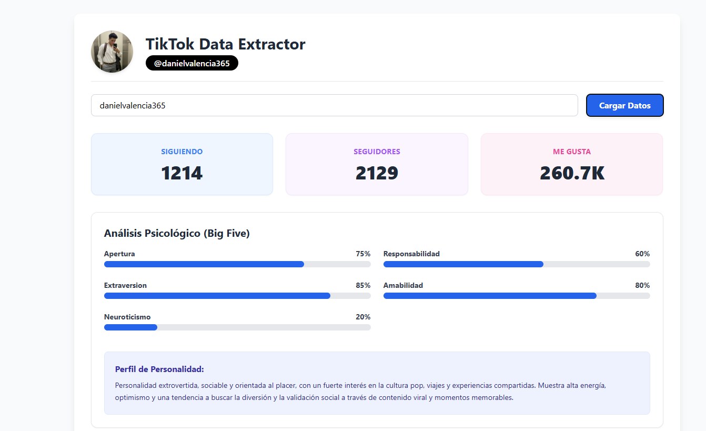
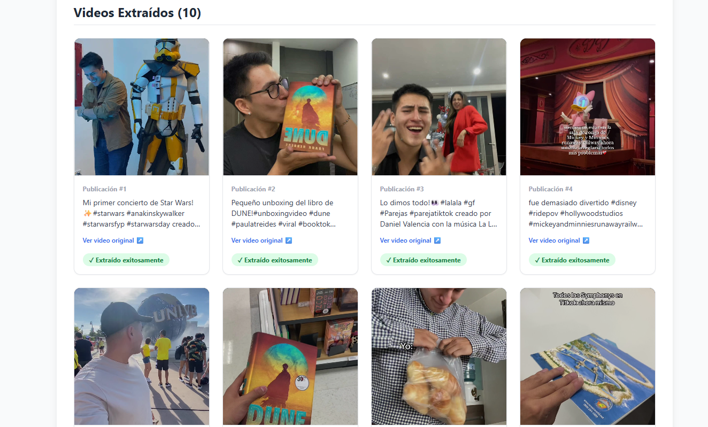

# 📊 TikTok Data Extractor + Análisis de Personalidad Big Five

Proyecto que **extrae datos públicos de un perfil de TikTok**, los guarda en un archivo JSON, los analiza con **Inteligencia Artificial** para estimar los rasgos del modelo de personalidad **Big Five (OCEAN)** y los muestra en un **dashboard web**.

> **Proyecto académico – UCE.** Los resultados son una estimación automática con fines educativos, no un diagnóstico psicológico.

---

## 📑 Contenido

1. [¿Qué hace este proyecto?](#-qué-hace-este-proyecto)
2. [Estructura del proyecto](#-estructura-del-proyecto)
3. [Instalación](#-instalación)
4. [Configuración](#-configuración)
5. [Cómo usarlo](#-cómo-usarlo)
6. [Explicación de cada archivo](#-explicación-de-cada-archivo)
7. [Ejemplo del JSON generado](#-ejemplo-del-json-generado)
8. [¿Qué es el modelo Big Five?](#-qué-es-el-modelo-big-five)
9. [Problemas comunes](#-problemas-comunes)
10. [Limitaciones y consideraciones éticas](#-limitaciones-y-consideraciones-éticas)

---

## 🎯 ¿Qué hace este proyecto?

| Etapa | Archivo | ¿Qué hace? |
|-------|---------|------------|
| 1. Extracción | `main.py` | Abre un navegador automatizado, entra al perfil de TikTok y guarda estadísticas, foto y los últimos 10 videos con sus descripciones. |
| 2. Análisis | `analisis_bigfive.py` | Envía las descripciones a una IA (API de Groq) y guarda la estimación de los 5 rasgos de personalidad. |
| 3. Visualización | `index.html` | Dashboard web que lee el JSON y muestra perfil, barras de personalidad y videos. |

```
Usuario de TikTok ──► main.py ──► datos_<usuario>.json ──► analisis_bigfive.py ──► (mismo JSON + "analisis_bigfive") ──► index.html
```

`main.py` ejecuta automáticamente el análisis al terminar la extracción. También puedes correr `analisis_bigfive.py` por separado, con cualquier perfil ya extraído.

---

## 📁 Estructura del proyecto

```
scraper-tiktok-uce/
├── main.py                  # Extracción (Playwright) + lanza el análisis
├── analisis_bigfive.py      # Análisis Big Five con IA (Groq)
├── index.html               # Dashboard web
├── requirements.txt         # Dependencias de Python
├── .env.example             # Plantilla de configuración
├── .gitignore               # Evita subir claves y datos personales
├── .env                     # TU configuración real (no se sube a Git)
├── datos_<usuario>.json     # Generado automáticamente por perfil
└── perfil_tiktok/           # Sesión del navegador (se crea sola)
```

---

## ⚙️ Instalación

```bash
git clone <URL-de-tu-repositorio>
cd scraper-tiktok-uce

# Entorno virtual (recomendado)
python -m venv venv
source venv/Scripts/activate      # Git Bash / Windows
# source venv/bin/activate        # Mac / Linux

pip install -r requirements.txt
playwright install chromium
```

Requiere **Python 3.9 o superior**. `requirements.txt` instala `playwright`, `requests` y `python-dotenv`.

---

## 🔑 Configuración

El análisis necesita una **API Key de Groq** (puedes crear una en [console.groq.com](https://console.groq.com)). La clave **no se escribe en el código**: se lee desde una variable de entorno.

### Opción A: archivo `.env` (recomendada)

```bash
cp .env.example .env
```

Edita `.env`:

```
GROQ_API_KEY=tu_clave_aqui
GROQ_MODEL=qwen/qwen3.8-27b
```

### Opción B: variable de entorno en la terminal

```bash
export GROQ_API_KEY="tu_clave"        # Git Bash / Mac / Linux
set GROQ_API_KEY=tu_clave             # Windows CMD
```

| Variable | Obligatoria | Descripción |
|----------|-------------|-------------|
| `GROQ_API_KEY` | Sí | Tu clave de la API de Groq. |
| `GROQ_MODEL` | No | Modelo a usar. Por defecto: `qwen/qwen3.8-27b`. |

> ⚠️ Nunca subas tu `.env` a GitHub. Ya está incluido en `.gitignore`. Si tu clave se expuso alguna vez, genera una nueva en Groq.

---

## 🚀 Cómo usarlo

### 1. Extraer y analizar un perfil (todo en uno)

```bash
python main.py                      # te pregunta el usuario
python main.py danielvalencia365    # usuario como argumento
python main.py usuario --sin-analisis   # solo extrae, sin IA
```

Se abrirá Chrome. Si TikTok muestra un **Captcha**, resuélvelo manualmente (el programa espera hasta 60 segundos). Al terminar se crea `datos_<usuario>.json` con el análisis incluido.

### 2. Analizar perfiles ya extraídos

```bash
python analisis_bigfive.py                      # te pregunta el usuario
python analisis_bigfive.py danielvalencia365    # por usuario
python analisis_bigfive.py datos_ana.json       # por archivo
python analisis_bigfive.py usuario1 usuario2    # varios a la vez
python analisis_bigfive.py --todos              # todos los datos_*.json de la carpeta
```

### 3. Ver los modelos disponibles o usar otro

```bash
python analisis_bigfive.py --listar-modelos
python analisis_bigfive.py usuario --modelo nombre-del-modelo
```

### 4. Ver el dashboard

El dashboard lee el JSON con `fetch()`, por lo que **no funciona abriendo el HTML con doble clic**. Sírvelo desde un servidor local, en la carpeta del proyecto:

```bash
python -m http.server 8000
```

Abre **http://localhost:8000/index.html**, escribe el usuario y presiona **Cargar Datos**.

---

## 📖 Explicación de cada archivo

### `main.py` – Extracción de datos

Usa **Playwright** para controlar un navegador real:

1. Abre Chromium con **sesión persistente** (`perfil_tiktok/`) para reducir Captchas.
2. Entra a `https://www.tiktok.com/@usuario`.
3. Extrae **siguiendo, seguidores y me gusta**, y la **foto de perfil** (con imagen de reemplazo si falla).
4. Hace **scroll simulado** para que TikTok cargue los videos.
5. Captura **enlace, miniatura y descripción** de cada video, sin duplicados, y conserva los primeros 10.
6. Guarda todo en `datos_<usuario>.json` (UTF-8) y, si no usaste `--sin-analisis`, llama al análisis Big Five.

> Los selectores como `strong[title="Seguidores"]` están en **español**: TikTok debe mostrarse en ese idioma. Si no, ajusta esos textos.

### `analisis_bigfive.py` – Análisis con IA

1. Lee la API Key desde `GROQ_API_KEY` y el modelo desde `GROQ_MODEL`.
2. Abre el JSON del perfil e ignora las descripciones vacías o "Sin descripción disponible".
3. Une las descripciones (máximo 6000 caracteres) y le pide a la IA un JSON con `Apertura`, `Responsabilidad`, `Extraversion`, `Amabilidad`, `Neuroticismo` (0 a 100) y un `resumen`.
4. Procesa la respuesta: ignora bloques `<think>` y texto extra, y verifica que estén los 5 rasgos con valores entre 0 y 100.
5. Guarda el resultado en el mismo archivo bajo la clave `analisis_bigfive`.

### `index.html` – Dashboard

Muestra foto y usuario, tarjetas de estadísticas, **barras de progreso** de cada rasgo con el resumen de personalidad (si el JSON ya fue analizado) y la **cuadrícula de videos** con miniatura, descripción y enlace original.

---

## 🧾 Ejemplo del JSON generado

```json
{
    "usuario": "danielvalencia365",
    "perfil": {
        "foto_perfil": "https://p16-common-sign.tiktokcdn.com/tos-maliva-avt-0068/91d69fc1507151cdd419d923eab6d43e~tplv-tiktokx-cropcenter:1080:1080.jpeg?dr=14579&refresh_token=38f86b50&x-expires=1792875600&x-signature=CkPhWHBTB8Z1bpyBGsCpfCn3jxw%3D&t=4d5b0474&ps=13740610&shp=a5d48078&shcp=81f88b70&idc=my3",
        "siguiendo": "1214",
        "seguidores": "2129",
        "me_gusta": "260.7K"
    },
    "videos_recientes": [
        {
            "posicion": 1,
            "enlace": "https://www.tiktok.com/@danielvalencia365/video/7502953069521456439",
            "miniatura": "https://p16-common-sign.tiktokcdn.com/tos-maliva-p-0068/o4EZSAREIBAfBQAfAoAQ9ItzJCFgg2HD9kYWqs~tplv-tiktokx-origin.image?dr=14575&x-expires=1792875600&x-signature=Tq4yz2YuabNNIHyfKKuQcpezRTw%3D&t=4d5b0474&ps=13740610&shp=81f88b70&shcp=43f4a2f9&idc=my2",
            "descripcion": "Mi primer concierto de Star Wars! ✨#starwars #anakinskywalker #starwarsfyp #starwarsday  creado por Daniel Valencia con la música Star Wars - Produced de Ettore Stratta",
            "estado": "Extraído exitosamente"
        },
        {
            "posicion": 2,
            "enlace": "https://www.tiktok.com/@danielvalencia365/video/7454306956283530502",
            "miniatura": "https://p16-common-sign.tiktokcdn.com/tos-maliva-p-0068/ooAAwIA0zqnAeRTBcuEyCFcERBLDWQSJpEfBkm~tplv-tiktokx-origin.image?dr=14575&x-expires=1792875600&x-signature=aoVNknsRXNpx9FmdIlOO7XQF6S8%3D&t=4d5b0474&ps=13740610&shp=81f88b70&shcp=43f4a2f9&idc=my2",
            "descripcion": "Pequeño unboxing del libro de DUNE!#unboxingvideo #dune  #paulatreides #viral #booktok  creado por Daniel Valencia con la música BIRDS OF A FEATHER de Billie Eilish",
            "estado": "Extraído exitosamente"
        },
        {
            "posicion": 3,
            "enlace": "https://www.tiktok.com/@danielvalencia365/video/7452760253722053893",
            "miniatura": "https://p16-common-sign.tiktokcdn.com/tos-maliva-p-0068/o4AHCYwhDQDfAbzXAjFAJ6R8pCfBnABIEoQQEb~tplv-tiktokx-origin.image?dr=14575&x-expires=1792875600&x-signature=YTCSZwTQd7W2d%2FEKOYAGM8SGVeg%3D&t=4d5b0474&ps=13740610&shp=81f88b70&shcp=43f4a2f9&idc=my2",
            "descripcion": "Lo dimos todo!👀#lalala #gf #Parejas #parejatiktok  creado por Daniel Valencia con la música La La La - Sped Up Version de Naughty Boy & Sam Smith",
            "estado": "Extraído exitosamente"
        },
        {
            "posicion": 4,
            "enlace": "https://www.tiktok.com/@danielvalencia365/video/7417292548919545093",
            "miniatura": "https://p16-common-sign.tiktokcdn.com/tos-maliva-p-0068/93aefe213815437cb7597f76693323d9_1726973008~tplv-tiktokx-origin.image?dr=14575&x-expires=1792875600&x-signature=uRIfdwqOgmXKB0H8sv8J4AXYsgI%3D&t=4d5b0474&ps=13740610&shp=81f88b70&shcp=43f4a2f9&idc=my2",
            "descripcion": "fue demasiado divertido  #disney #ridepov #hollywoodstudios #mickeyandminniesrunawayrailway  creado por Daniel Valencia con la música sonido original de Daniel Valencia",
            "estado": "Extraído exitosamente"
        },
        {
            "posicion": 5,
            "enlace": "https://www.tiktok.com/@danielvalencia365/video/7412425582337756421",
            "miniatura": "https://p16-common-sign.tiktokcdn.com/tos-maliva-p-0068/o06EB3gJnQAjclJ6OWcm8fCfQQE5XBDOmIJRKF~tplv-tiktokx-origin.image?dr=14575&x-expires=1792875600&x-signature=e3x62Mq96CGJIjI9veEMqY44FxM%3D&t=4d5b0474&ps=13740610&shp=81f88b70&shcp=43f4a2f9&idc=my2",
            "descripcion": "Uno de los mejores dias de mi vida! ❤️#universalstudios #harrypotter #orlandoflorida  creado por Daniel Valencia con la música sonido original de Daniel Valencia",
            "estado": "Extraído exitosamente"
        },
        {
            "posicion": 6,
            "enlace": "https://www.tiktok.com/@danielvalencia365/video/7410479795697487109",
            "miniatura": "https://p16-common-sign.tiktokcdn.com/tos-maliva-p-0068/08f430e71c6947f3a12bb7bef73c4439_1725386794~tplv-tiktokx-origin.image?dr=14575&x-expires=1792875600&x-signature=MKGI%2FgWhr7lkQ6RnHqtILGBCaO0%3D&t=4d5b0474&ps=13740610&shp=81f88b70&shcp=43f4a2f9&idc=my2",
            "descripcion": "Buscando libros en Target! 🎯 #book #target #librosespañol #dune  creado por Daniel Valencia con la música sonido original de Daniel Valencia",
            "estado": "Extraído exitosamente"
        },
        {
            "posicion": 7,
            "enlace": "https://www.tiktok.com/@danielvalencia365/video/7407831828595494149",
            "miniatura": "https://p16-common-sign.tiktokcdn.com/tos-maliva-p-0068/82c8a65ae8d8490e93d506281d34ddf9_1724770259~tplv-tiktokx-origin.image?dr=14575&x-expires=1792875600&x-signature=aFYBqwacRpuz7qgH5%2BKqsn6aAnI%3D&t=4d5b0474&ps=13740610&shp=81f88b70&shcp=43f4a2f9&idc=my2",
            "descripcion": "Diganme que no soy el único:( #viral #fryp #humor  creado por Daniel Valencia con la música sonido original de Daniel Valencia",
            "estado": "Extraído exitosamente"
        },
        {
            "posicion": 8,
            "enlace": "https://www.tiktok.com/@danielvalencia365/video/7407232682230353158",
            "miniatura": "https://p16-common-sign.tiktokcdn.com/tos-maliva-p-0068/oYmfILVEADEg6Q1REx0BfFuoaBJMsQ6XR8yZXC~tplv-tiktokx-origin.image?dr=14575&x-expires=1792875600&x-signature=7KHXL7Z6eaCCwawBI9l6R6XbBPg%3D&t=4d5b0474&ps=13740610&shp=81f88b70&shcp=43f4a2f9&idc=my2",
            "descripcion": "Desde cuando los delfines tiene una canción #symphony #dolphin #fryp  creado por Daniel Valencia con la música Symphony de Clean Bandit,Zara Larsson",
            "estado": "Extraído exitosamente"
        },
        {
            "posicion": 9,
            "enlace": "https://www.tiktok.com/@danielvalencia365/video/7396801553195175173",
            "miniatura": "https://p16-common-sign.tiktokcdn.com/tos-maliva-p-0068/ocMNFS97gCIT3QQl68jbIfwCswW4WgxeDtAfWN~tplv-tiktokx-origin.image?dr=14575&x-expires=1792875600&x-signature=H9BJ%2B5cqxd7Zwpg7Cz1Ng32IIJE%3D&t=4d5b0474&ps=13740610&shp=81f88b70&shcp=43f4a2f9&idc=my2",
            "descripcion": "Mori de risa toda la película 😂#deadpoolandwolverine #marvel #deadpool3 #deadpoolwolverine  creado por Daniel Valencia con la música Bye Bye Bye de *NSYNC",
            "estado": "Extraído exitosamente"
        },
        {
            "posicion": 10,
            "enlace": "https://www.tiktok.com/@danielvalencia365/video/7395676230688754950",
            "miniatura": "https://p16-common-sign.tiktokcdn.com/tos-maliva-p-0068/77a73737ad974857a7829441f6bcd9ba_1721940067~tplv-tiktokx-origin.image?dr=14575&x-expires=1792875600&x-signature=sVIDxytuB4v6Pwtlf0Pp8luM4Jw%3D&t=4d5b0474&ps=13740610&shp=81f88b70&shcp=43f4a2f9&idc=my2",
            "descripcion": "Listos para la Graduación! 🧑🏻‍🎓🎉#prom2024 #graduacion #traje #formal  creado por Daniel Valencia con la música BIRDS OF A FEATHER sped up de Lilly (unraveled)",
            "estado": "Extraído exitosamente"
        }
    ],
    "analisis_bigfive": {
        "Apertura": 75,
        "Responsabilidad": 60,
        "Extraversion": 85,
        "Amabilidad": 80,
        "Neuroticismo": 20,
        "resumen": "Personalidad extrovertida, sociable y orientada al placer, con un fuerte interés en la cultura pop, viajes y experiencias compartidas. Muestra alta energía, optimismo y una tendencia a buscar la diversión y la validación social a través de contenido viral y momentos memorables."
    }
}
```

---


---




## 🧠 ¿Qué es el modelo Big Five?

También conocido como **OCEAN**, describe la personalidad en cinco dimensiones:

| Rasgo | Significa… | Puntaje alto | Puntaje bajo |
|-------|-----------|--------------|--------------|
| **O**penness (Apertura) | Curiosidad y creatividad | Imaginativo, abierto a nuevas ideas | Práctico, prefiere lo conocido |
| **C**onscientiousness (Responsabilidad) | Organización y disciplina | Ordenado, cumplido | Espontáneo, flexible |
| **E**xtraversion (Extraversión) | Energía social | Sociable, expresivo | Reservado, tranquilo |
| **A**greeableness (Amabilidad) | Empatía y cooperación | Cálido, colaborador | Directo, competitivo |
| **N**euroticism (Neuroticismo) | Sensibilidad emocional | Más ansioso o reactivo | Calmado, estable |

---

## 🩺 Problemas comunes

| Problema | Posible causa | Solución |
|----------|---------------|----------|
| *"TikTok bloqueó la conexión o saltó un Captcha"* | Detección de bot o página que no cargó | Borra `perfil_tiktok/`, espera unos minutos, reintenta y resuelve el Captcha a mano. |
| No encuentra los selectores de estadísticas | TikTok cambió su HTML o el idioma no es español | Actualiza los selectores en `main.py`. |
| *"no se encontró la variable de entorno GROQ_API_KEY"* | No configuraste la clave | Revisa tu `.env` o exporta la variable. |
| Error 401 de la API | API Key inválida | Genera una nueva en Groq. |
| Error 404 `model_not_found` | Tu cuenta no tiene acceso a ese modelo | Ejecuta `--listar-modelos` y cambia `GROQ_MODEL`. |
| *"Error procesando la respuesta de la IA"* | La IA no devolvió un JSON válido | Vuelve a ejecutar el análisis. |
| *"no tiene descripciones de videos"* | Los videos no traen texto | Prueba con otro perfil. |
| El dashboard no encuentra el archivo | Abriste el HTML con doble clic o el usuario no coincide | Usa `python -m http.server` y escribe el usuario exacto. |

---

## ⚖️ Limitaciones y consideraciones éticas

- **No es un test psicológico validado.** La IA estima rasgos a partir de pocas descripciones y hashtags. Los porcentajes son orientativos.
- **Muestra pequeña:** solo se analizan 10 videos.
- **Privacidad:** usa únicamente cuentas públicas, con fines educativos y, cuando sea posible, con consentimiento de la persona. No tomes decisiones sobre nadie con estos resultados.
- **Términos de uso:** el scraping puede ir contra los términos de TikTok y su estructura cambia a menudo, por lo que el código puede requerir mantenimiento.
- **Datos enviados a terceros:** las descripciones se envían a la API de Groq para ser procesadas.

---

## 👤 Autor

**[Daniel Valencia Torres]** – Universidad Central del Ecuador (UCE)
📧 [devalenciat@uce.edu.ec]

## 📄 Repositorio
 Url:https://github.com/DanielValenc/scraper-tiktok-uce.git

